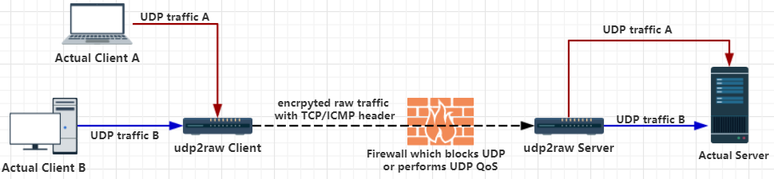
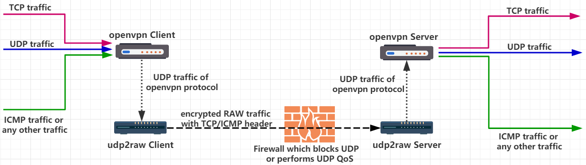
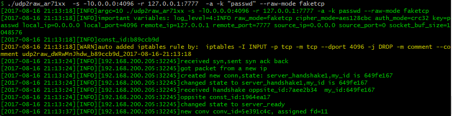
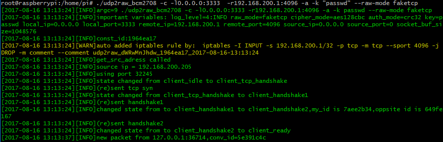
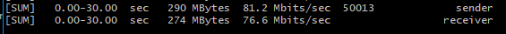
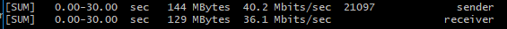

# udp2raw-tunnel

A tunnel that converts UDP traffic into encrypted FakeTCP, UDP, or ICMP traffic using raw sockets. It can help bypass UDP firewalls, UDP QoS restrictions, and unstable UDP network conditions.

When used alone, udp2raw tunnels only UDP traffic. When combined with a UDP-based VPN, it can tunnel other types of traffic, including TCP, UDP, and ICMP. OpenVPN, L2TP, ShadowVPN, and [tinyfecVPN](https://github.com/wangyu-/tinyfecVPN) are currently confirmed to be supported.



Alternatively:



[udp2raw wiki](https://github.com/wangyu-/udp2raw-tunnel/wiki)

[简体中文](/doc/README.zh-cn.md)

## Supported platforms

Linux hosts are supported, including desktop Linux, Android phones and tablets, OpenWrt routers, and Raspberry Pi devices. A root account or `CAP_NET_RAW` capability is required.

Windows and macOS users should use the udp2raw version from [this repository](https://github.com/wangyu-/udp2raw-multiplatform).

## Features

### Send and receive UDP packets with ICMP, FakeTCP, or UDP headers

ICMP and FakeTCP headers can help bypass UDP blocking, UDP QoS restrictions, or improper UDP NAT behavior on some ISPs. In ICMP mode, udp2raw works like an ICMP tunnel.

UDP headers are also supported. In UDP-header mode, udp2raw behaves like a normal UDP tunnel while providing additional features such as encryption, anti-replay protection, and connection recovery.

### Simulated TCP with real-time and out-of-order delivery

In FakeTCP mode, udp2raw simulates a three-way handshake when establishing a connection and simulates sequence and acknowledgment numbers while transferring data.

It also simulates several TCP options, including `MSS`, `sackOk`, `TS`, `TS_ack`, and `wscale`.

Firewalls may interpret FakeTCP traffic as a TCP connection, but it is essentially UDP. It supports real-time and out-of-order delivery, like normal UDP, but does not provide TCP congestion control or retransmission. Therefore, it avoids the TCP-over-TCP problems that can occur when using OpenVPN over TCP.

### Encryption and anti-replay protection

- Encrypts traffic using AES-128-CBC.
- Protects data integrity using HMAC-SHA1, MD5, or CRC32.
- Helps defend against replay attacks with an anti-replay window.

See the [notes on encryption](https://github.com/wangyu-/udp2raw-tunnel/wiki/Notes-on-encryption).

### Failure detection and connection recovery

udp2raw detects connection failures using heartbeat packets. When a connection times out, the client automatically changes its port and attempts to reconnect.

If reconnection succeeds, the previous connection is restored and existing UDP conversations remain valid.

For example, when udp2raw is used with OpenVPN, the OpenVPN connection can survive a network cable reconnect or a change of Wi-Fi access point.

### Other features

- **Multiplexing:** One client can handle multiple UDP connections, all of which share the same raw connection.
- **Multiple clients:** One server can support multiple clients.
- **NAT support:** All three modes work in NAT environments.
- **OpenVZ support:** Tested on BandwagonHost VPS.
- **Easy to build:** The project has no external dependencies. To cross-compile udp2raw, download a toolchain, modify the Makefile to point to the toolchain, and run `make cross`. Precompiled binaries for desktop Linux, Raspberry Pi, Android, and some OpenWrt routers are available in the [releases](https://github.com/wangyu-/udp2raw-tunnel/releases).

### Keywords

`Bypass UDP QoS` `Bypass UDP Blocking` `Avoid OpenVPN TCP-over-TCP Problems` `OpenVPN over ICMP` `UDP to ICMP Tunnel` `UDP to TCP Tunnel` `UDP over ICMP` `UDP over TCP`

## Getting started

### Installation

Download a binary release from the [releases page](https://github.com/wangyu-/udp2raw-tunnel/releases).

### Running udp2raw

Assume that UDP traffic is blocked, subject to QoS restrictions, or poorly supported. Also assume that:

- The server IP address is `44.55.66.77`.
- A service is listening on UDP port `7777` on the server.
- udp2raw will listen on port `4096` on the server.
- udp2raw will listen on port `3333` on the client.

#### Server

```bash
./udp2raw_amd64 \
  -s \
  -l 0.0.0.0:4096 \
  -r 127.0.0.1:7777 \
  -k "passwd" \
  --raw-mode faketcp \
  -a
```

#### Client

```bash
./udp2raw_amd64 \
  -c \
  -l 0.0.0.0:3333 \
  -r 44.55.66.77:4096 \
  -k "passwd" \
  --raw-mode faketcp \
  -a
```

The commands above must be run as root. With a few additional steps, udp2raw can also run as a non-root user. See the [run udp2raw as non-root](https://github.com/wangyu-/udp2raw-tunnel/wiki/run-udp2raw-as-non-root) guide for more information.

#### Server output



#### Client output



An encrypted raw tunnel is now established between the client and server through TCP port `4096`. Connecting to UDP port `3333` on the client is equivalent to connecting to UDP port `7777` on the server. No original UDP traffic is exposed directly to the network.

### Important note

The `-a` option automatically adds one or more iptables rules. udp2raw relies on these rules for stable operation, so do not forget to include `-a`. This is a common configuration mistake.

If you do not want udp2raw to add the iptables rules automatically, add them manually using the `-g` option and omit `-a`.

To run udp2raw on Android, see the [Android guide](https://github.com/wangyu-/udp2raw/wiki/Android-Guide).

## Advanced topics

### Usage

```text
udp2raw-tunnel
git version:4623f878e0    build date:Nov  3 2024 23:15:46
repository: https://github.com/wangyu-/udp2raw-tunnel

usage:
    run as client : ./this_program -c -l local_listen_ip:local_port -r server_address:server_port  [options]
    run as server : ./this_program -s -l server_listen_ip:server_port  -r remote_address:remote_port  [options]

common options,these options must be same on both side:
    --raw-mode            <string>        available values:faketcp(default),udp,icmp and easy-faketcp
    -k,--key              <string>        password to gen symetric key,default:"secret key"
    --cipher-mode         <string>        available values:aes128cfb,aes128cbc(default),xor,none
    --auth-mode           <string>        available values:hmac_sha1,md5(default),crc32,simple,none
    -a,--auto-rule                        auto add (and delete) iptables rule
    -g,--gen-rule                         generate iptables rule then exit,so that you can copy and
                                          add it manually.overrides -a
    --disable-anti-replay                 disable anti-replay,not suggested
    --fix-gro                             try to fix huge packet caused by GRO. this option is at an early stage.
                                          make sure client and server are at same version.
client options:
    --source-ip           <ip>            force source-ip for raw socket
    --source-port         <port>          force source-port for raw socket,tcp/udp only
                                          this option disables port changing while re-connecting
other options:
    --conf-file           <string>        read options from a configuration file instead of command line.
                                          check example.conf in repo for format
    --fifo                <string>        use a fifo(named pipe) for sending commands to the running program,
                                          check readme.md in repository for supported commands.
    --log-level           <number>        0:never    1:fatal   2:error   3:warn
                                          4:info (default)     5:debug   6:trace
    --log-position                        enable file name,function name,line number in log
    --disable-color                       disable log color
    --dev                 <string>        bind raw socket to a device, not necessary but improves performance
    --sock-buf            <number>        buf size for socket,>=10 and <=10240,unit:kbyte,default:1024
    --force-sock-buf                      bypass system limitation while setting sock-buf
    --seq-mode            <number>        seq increase mode for faketcp:
                                          0:static header,do not increase seq and ack_seq
                                          1:increase seq for every packet,simply ack last seq
                                          2:increase seq randomly, about every 3 packets,simply ack last seq
                                          3:simulate an almost real seq/ack procedure(default)
                                          4:similiar to 3,but do not consider TCP Option Window_Scale,
                                          maybe useful when firewall doesnt support TCP Option
    --lower-level         <string>        send packets at OSI level 2, format:'if_name#dest_mac_adress'
                                          ie:'eth0#00:23:45:67:89:b9'.or try '--lower-level auto' to obtain
                                          the parameter automatically,specify it manually if 'auto' failed
    --wait-lock                           wait for xtables lock while invoking iptables, need iptables v1.4.20+
    --gen-add                             generate iptables rule and add it permanently,then exit.overrides -g
    --keep-rule                           monitor iptables and auto re-add if necessary.implys -a
    --hb-len              <number>        length of heart-beat packet, >=0 and <=1500
    --mtu-warn            <number>        mtu warning threshold, unit:byte, default:1375
    --clear                               clear any iptables rules added by this program.overrides everything
    --retry-on-error                      retry on error, allow to start udp2raw before network is initialized
    -h,--help                             print this help message
```

### iptables rules: `-a` and `-g`

udp2raw sends packets using raw sockets. In FakeTCP mode, Linux kernel TCP packet processing must be blocked by an iptables rule on both sides. Otherwise, the kernel may automatically send an RST packet for an unrecognized TCP packet, causing stability and performance problems.

Use the `-a` option to let udp2raw add and remove the iptables rule automatically when the program starts and exits.

Alternatively, use the `-g` option to generate the iptables rule and add it manually.

### `--cipher-mode` and `--auth-mode`

For maximum security, `aes128cbc` with `hmac_sha1` is recommended.

If you are running the program on a router, you can try `xor` with `simple`. This may fool some firewalls, but it cannot protect you against serious attacks.

The `none` mode is intended only for debugging. It is not recommended for normal use.

### `--seq-mode`

FakeTCP mode does not behave exactly like a real TCP connection. ISPs may be able to distinguish simulated TCP traffic from real TCP traffic, although doing so may be expensive.

The `--seq-mode` option changes how sequence numbers are generated. If you experience connection problems, try a different value.

### `--lower-level`

The `--lower-level` option allows udp2raw to send packets at OSI Layer 2, which can bypass local iptables rules.

If you have complicated iptables rules that conflict with udp2raw and cannot—or do not want to—edit them, `--lower-level` may be useful.

Try `--lower-level auto` first. If automatic detection fails, specify the interface and destination MAC address manually.

The manual format is:

```text
if_name#destination_mac_address
```

For example:

```text
eth0#00:23:45:67:89:b9
```

### `--keep-rule`

The `--keep-rule` option monitors the iptables rules and automatically adds them again if necessary.

This is especially useful on OpenWrt, where changing and committing a setting may cause iptables rules to be removed and rebuilt.

### `--conf-file`

You can load options from a configuration file instead of specifying them on the command line. This keeps passwords and other options out of the process list.

For example, rewrite the server command from the Getting Started section as follows.

`server.conf`:

```text
-s
# Comments must occupy an entire line.
# Inline comments are not supported.
# Listen address
-l 0.0.0.0:4096
# Remote address
-r 127.0.0.1:7777
-a
-k passwd
--raw-mode faketcp
```

Pay attention to the `-k` parameter. In command-line mode, the shell removes quotation marks around the password. In configuration-file mode, quotation marks are not removed.

Start the server with:

```bash
./udp2raw_amd64 --conf-file server.conf
```

### `--fifo`

The `--fifo` option uses a named pipe to send commands to a running program. For example:

```bash
./udp2raw_amd64 ... --fifo fifo.file
```

At the client, use the following command to force a reconnection:

```bash
echo reconnect > fifo.file
```

Currently, no commands have been implemented for the server.

## Performance test

### Test method

The test measures TCP traffic from `iperf3` through OpenVPN and udp2raw.

The `iperf3` UDP mode is not used because of a bug described in [iperf issue #296](https://github.com/esnet/iperf/issues/296). Instead, TCP traffic is packaged into UDP by OpenVPN for testing. See the [Application](https://github.com/wangyu-/udp2raw-tunnel#application) section for more information.

### iperf3 commands

```bash
iperf3 -c 10.222.2.1 -P40
iperf3 -c 10.222.2.1 -P40 -R
```

### Test environment

- **Client:** Vultr $2.5/month plan, single-core 2.4 GHz CPU, 512 MB RAM, Tokyo, Japan.
- **Server:** BandwagonHost $3.99/year plan, single-core 2.0 GHz CPU, 128 MB RAM, Los Angeles, USA.

### Test 1

```text
raw_mode: faketcp
cipher_mode: xor
auth_mode: simple
```



Reverse-direction speed was similar, so it was not uploaded separately.

### Test 2

```text
raw_mode: faketcp
cipher_mode: aes128cbc
auth_mode: md5
```



Reverse-direction speed was similar, so it was not uploaded separately.

## Wiki

See the [wiki](https://github.com/wangyu-/udp2raw-tunnel/wiki) for more information.

## Contributing

Documentation improvements, bug fixes, testing, and reproducible performance reports are welcome.

When submitting a documentation pull request, please preserve the existing command-line examples, option names, links, and image paths unless the change is intentional and verified.
